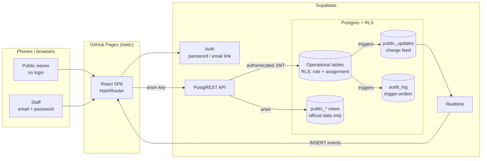

# WOTB Tournament Tracker

A mobile-first tournament tracker for the WOTB sports tournament. It handles the
schedule, brackets, score entry, result editing, placements, and the Commander's
Cup overall leaderboard.

**How scoring works:** each competing **unit** enters **teams** in the individual sports.
A team's final placing in its sport (1st = 8 points … 8th = 1 point) earns points for its
unit. The public Commander's Cup leaderboard ranks the **units** by their total.

- **Frontend:** a static React + TypeScript + Vite site, deployed to **GitHub Pages**. It
  uses hash routes (`/#/public`, `/#/sport/SOC`, `/#/ops`).
- **Backend:** **Supabase**. It provides Postgres, Auth (email + password), Row Level Security
  (RLS), and Realtime. No server runs on GitHub Pages.

> **Security operating guidance (read first)**
>
> - **GitHub Pages is public static hosting.** Anyone with the URL can load the site.
> - **Do not commit secrets.** Never put the Supabase **service-role key**, database
>   passwords or private API credentials in the repo, frontend code, Actions logs or
>   Pages. The service-role key must **never** be used in the browser.
> - The Supabase **anon key** is in the browser bundle by design. That is safe only
>   because **all sensitive access is enforced by tested RLS policies**, not by hidden
>   buttons in the interface.
> - **Do not enter** protected health information, passwords, personally sensitive notes
>   or unnecessary personal data. Staff emails are restricted. Only authenticated,
>   activated staff can see them.
> - **Use named accounts.** Every score submission is tied to an authenticated person.
>   Each person gets their own account and password; accounts must not be shared.
> - **QR codes are navigation aids only.** They open the site or a sport page. They never
>   sign anyone in and never authorize score entry.
> - Organization approval, data-handling, access, records and release policies still
>   apply before operational use.

## Architecture



How it works:

- Public pages read only the `public_*` views. Those views expose official, public-safe
  columns. The anon role has no access to any raw table.
- Staff pages read and write the raw tables. RLS decides what each user can do, based on
  their profile role plus their event and venue assignments.
- Results entered by event administrators (operations admins, sport managers, venue
  leads) are Official immediately. Results from Scorer accounts wait for approval.
  Triggers check that the winner is in the match and that values aren't negative. An
  Official result is changed only through **Edit result**, which keeps the old version
  and the reason in `audit_log`. Every change also bumps `public_updates`.
- Public clients subscribe to `public_updates` through Realtime and refetch when an
  official change lands. They fall back to polling every 60 seconds.

## Repository layout

```
src/                     React app
  lib/domain/            Pure logic (points, validation, advancement, bracket) + tests
  lib/api/               React Query hooks (public views / ops tables)
  pages/public/          Public dashboard + sport detail
  pages/ops/             Staff pages (score entry, approvals, setup, ...)
  components/            UI kit, Bracket Board, Score Entry form, Approval card
supabase/migrations/     Schema, triggers, RLS, public views (run in order)
supabase/seed.sql        Events, points matrix, scoring settings (no people / teams)
supabase/tests/          Local Postgres harness + workflow/RLS test
scripts/test-db.sh       Runs migrations + DB tests on a throwaway local Postgres
.github/workflows/       GitHub Pages deploy (lint, typecheck, tests, DB tests, build)
docs/                    Runbook, scorer guide, deployment, data model, test plan, assumptions
```

## Local development

Requirements: Node 20+. For the DB tests you also need PostgreSQL 15+ server binaries.

```bash
npm ci
```

```bash
cp .env.example .env.local   # then fill in VITE_SUPABASE_URL / VITE_SUPABASE_ANON_KEY
```

```bash
npm run dev                  # http://localhost:5173/scoreTracker/
```

```bash
npm run check                # lint + typecheck + unit/component tests + build
```

```bash
npm run test:db              # migrations + RLS/workflow tests on a temp Postgres
```

### Required environment variables

| Variable | Purpose |
|---|---|
| `VITE_SUPABASE_URL` | Supabase project URL (`https://xxxx.supabase.co`) |
| `VITE_SUPABASE_ANON_KEY` | Supabase **anon / publishable** key (public by design) |
| `VITE_APP_NAME` | Display name, default `WOTB Tournament Tracker` |
| `VITE_GITHUB_PAGES_BASE` | `/<REPOSITORY_NAME>/`, default `/scoreTracker/` |

`SUPABASE_SERVICE_ROLE_KEY` is **never** used anywhere in this project.

## Supabase setup

### 1. Create the project

1. Go to <https://supabase.com>, create a project, and choose a region near the
   tournament.
2. Copy the **Project URL** and the **anon / publishable key**. Both are under
   *Project Settings → API*.

### 2. Run the migrations

Use one of these two options.

**Option A, SQL Editor (simplest):** paste and run each file in
`supabase/migrations/` **in filename order**, then run `supabase/seed.sql`.

**Updating an existing project:** run only the migration files you haven't run yet, in
order. Each new migration is a new file; earlier files are never changed. For example, a
project set up with files `…0001`–`…0004` needs `…0005_explicit_grants.sql`,
`…0006_units_and_deletes.sql`, `…0007_fix_cascade_checks.sql` and
`…0008_direct_results_and_edits.sql` and `…0009_auto_advance.sql`, in that order.

### Sample data (optional, for trying the app)

- `supabase/sample/load_sample_data.sql` adds 4 sample units with Soccer and Basketball
  teams, a finished Soccer bracket with published placements (so the unit leaderboard
  shows points), and a Basketball bracket in progress. Everything is named `SAMPLE …`.
- `supabase/sample/remove_sample_data.sql` deletes exactly that and nothing else.

Run either in the SQL Editor. Remove the sample data before the event.

**Option B, Supabase CLI:**

```bash
npx supabase login
```

```bash
npx supabase link --project-ref <your-project-ref>
```

```bash
npx supabase db push
```

```bash
psql "$(npx supabase db url)" -f supabase/seed.sql
```

(Or paste `seed.sql` into the SQL Editor.)

### 3. Seed data and the preliminary schedule

`seed.sql` loads the 8 events, the 1st–8th points matrix (8 down to 1), and the scoring
settings: a no-show penalty of −6 and overall scoring on.

It creates **no** teams, rosters, seeds, results or users.

The preliminary Dec 7–9 schedule needs a year. Load it in either of two ways:

- **Ops → Settings → Load schedule**, after you create the first admin, or
- the SQL Editor: `select public.load_preliminary_schedule(2026);`

### 4. Auth settings

Staff sign in with **email + password**. Supabase stores and checks the passwords; the
app never stores them. Admins create every account, so no emails are needed to sign in.

- *Authentication → Sign In / Providers → Email*: make sure the Email provider is
  **enabled**. Password sign-in is part of it.
- On the same page, **disable "Allow new users to sign up"**. Even if sign-ups are left
  on, new accounts start **inactive** with no access.
- Set a **minimum password length** of at least 10 (in the Email provider or password
  settings). The app's Change Password page also requires 10 characters.
- Optional backup sign-in by email link: the sign-in page also offers "Sign in with an
  email link instead". It uses Supabase's built-in email sender, which allows only a few
  emails per hour. If you want to rely on it, configure custom SMTP (*Authentication →
  Emails → SMTP Settings*) and add `{{ .Token }}` to the **Magic Link** email template, for
  example `Or enter this code: {{ .Token }}`.
- **Redirect URLs** (*Authentication → URL Configuration*):
  - Site URL: `https://<owner>.github.io/<REPOSITORY_NAME>/`
  - Additional Redirect URLs:
    - `https://<owner>.github.io/<REPOSITORY_NAME>/`
    - `http://localhost:5173/<REPOSITORY_NAME>/`
    - `http://localhost:4173/<REPOSITORY_NAME>/` (for `npm run preview`)

  For this repository that is `https://catcode23.github.io/scoreTracker/`.

### 5. Create the first operations admin (bootstrap)

1. In Supabase, go to *Authentication → Users → Add user → **Create new user***. Enter
   your email and a password, and tick **Auto Confirm User**. A trigger creates an
   inactive `profiles` row.
2. In the **SQL Editor** (which runs with owner rights), run this with your email in the
   last line. It also creates the profile if your account existed before the migrations:

   ```sql
   insert into public.profiles (id, email, display_name, role, active)
   select id, lower(email), split_part(email, '@', 1), 'operations_admin', true
   from auth.users
   where lower(email) = lower('you@example.com')
   on conflict (id) do update set role = 'operations_admin', active = true
   returning id, email, role, active;
   ```

   It should return one row. If it returns none, check the spelling against
   `select email from auth.users;`.
3. Open the app, tap **Staff sign in**, and sign in with your email and password. You now
   see the full **Operations** menu.

### Adding staff

For each person:

1. Supabase: *Authentication → Users → Add user → Create new user*, with their email, a
   temporary password, and **Auto Confirm User** ticked. Don't use **Invite user**: the
   invite link doesn't work with this app's page routing, and it sends an email.
2. App: **Ops → Users** → activate them and add their event/venue assignment.
3. Give them the temporary password directly (in person or by phone, not in a group
   chat). They change it under **Change Password** after signing in.

To reset a forgotten password, open the user in Supabase (*Authentication → Users*) and
set a new password.

### 6. Realtime

The migration adds `public_updates`, `matches`, `match_results` and `corrections` to the
`supabase_realtime` publication. Check this under *Database → Publications*. Realtime
applies RLS, so anonymous clients receive only the `public_updates` feed, which contains
no sensitive data.

## GitHub Pages deployment

See [docs/DEPLOYMENT.md](docs/DEPLOYMENT.md). In short:

1. In *Settings → Pages*, set **Source** to **GitHub Actions**.
2. In *Settings → Secrets and variables → Actions → **Variables***, add
   `VITE_SUPABASE_URL` and `VITE_SUPABASE_ANON_KEY`. They are public values, so use
   Variables, not Secrets.
3. Push to `main`. The workflow lints, typechecks, runs the unit, component and DB tests,
   builds, and deploys.

### Setting the Vite base path

A project-repository Pages site is served at `https://<owner>.github.io/<REPOSITORY_NAME>/`.
The base path **must** be `/<REPOSITORY_NAME>/`. It is resolved in this order:

1. the `VITE_GITHUB_PAGES_BASE` repository variable, if set;
2. otherwise, in CI, `/${{ github.event.repository.name }}/`, worked out automatically;
3. otherwise, locally, `VITE_GITHUB_PAGES_BASE` in `.env.local`, or the default
   `/scoreTracker/` in `vite.config.ts`.

If you rename the repository, update `.env.local` and the redirect URLs in Supabase.

## Documentation

- [docs/ADMIN_RUNBOOK.md](docs/ADMIN_RUNBOOK.md): pre-event setup through event close-out
- [docs/SCORER_QUICK_START.md](docs/SCORER_QUICK_START.md): one-page phone guide
- [docs/DEPLOYMENT.md](docs/DEPLOYMENT.md): GitHub Pages and Supabase configuration
- [docs/DATA_MODEL.md](docs/DATA_MODEL.md): tables, relationships, role model
- [docs/TEST_PLAN.md](docs/TEST_PLAN.md): test cases, the manual E2E script, test accounts
- [docs/ASSUMPTIONS.md](docs/ASSUMPTIONS.md): design assumptions

## Known limitations

- **No offline submission queue.** Staff use the paper scorecard when connectivity is
  lost (this is stated on the score-entry screen).
- **No automatic bracket generation.** Brackets are entered by hand or through CSV import.
  Advancement is automatic along the routing you set up, but never overwrites a filled
  slot. Anything it skips is moved by hand in Match Management.
- **Password resets are done by an admin** in Supabase. There is no self-service
  "forgot password" email, because that would depend on email delivery.
- **The backup email link needs the same browser.** It must be opened in the browser that
  requested it, or the emailed code used instead (once the template includes
  `{{ .Token }}`).
- **Hand-written database types.** The TypeScript row types in `src/lib/types.ts` are
  maintained by hand. Generating them with `supabase gen types` is a follow-on.
- **Supabase's built-in email limits.** Only the backup email-link sign-in sends email,
  and the built-in sender allows a few emails per hour. Configure custom SMTP if you plan
  to use it.
- **Expected linter warning.** The public views are owner-rights ("security definer")
  views on purpose. Supabase's linter will flag them, and this is expected. Each view
  selects only safe columns (see the migration header).
- **Placement tiebreakers are recorded, not computed.** Pool standings use a suggested
  rank (W=2/T=1, then point differential, then points for), which managers can override.

## Follow-on improvements

Possible next steps:

- a bracket generator from seeds;
- a QR code page per sport;
- an offline draft queue;
- generated DB types;
- Playwright E2E tests against a Supabase branch;
- CSV export of results.
