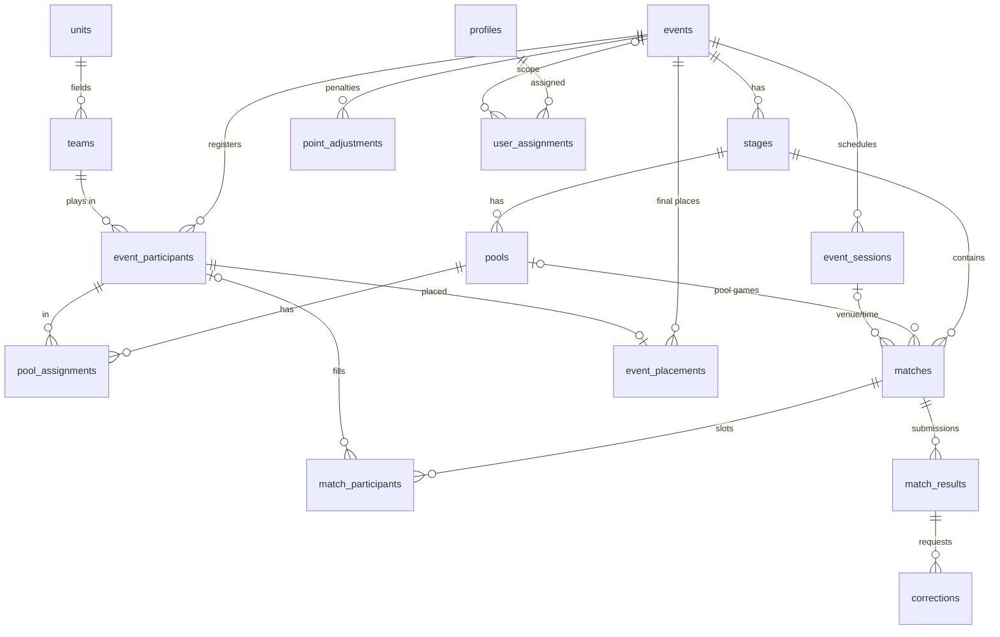

# Data Model

The source of truth is `supabase/migrations/`. Primary keys are UUIDs. `event_code` and
`match_code` are human-readable codes, used for URLs and paper scorecards.

## Relationships



## Tables

| Table | Purpose |
|---|---|
| `profiles` | One row per staff user (`auth.users.id`). Has a `role` and `active` (default **false**). Created by a trigger when someone first signs in. |
| `user_assignments` | Scopes a role to an event (null = all events) and a venue (null = all venues). A user can have many. |
| `events` | The 8 sports and their format, venue, unit, dates, target count, and public flag. |
| `units` | The competing units (managed list, operations admin only). The overall leaderboard totals points per unit. |
| `teams` | One record per team. `unit` must be a name from `units` (renames cascade; a unit with teams can't be deleted). `captain_name` is no longer used by the app and never appears in public views. Deleting a team deletes its registrations, unless it is in matches. |
| `event_participants` | A team registered in an event: seed, check-in status, eligibility, final place mirror. |
| `event_sessions` | Schedule blocks (date, time, venue). **No longer edited in the app**; kept for history and for matches that were linked to one. Match dates/times are the schedule now. |
| `stages` | Pool, elimination, consolation, heat, placement, or final, in order. |
| `pools` / `pool_assignments` | Pool membership and standings: W/L/T, PF/PA, differential, rank, advancement. |
| `matches` | A game, bout, heat or station. Holds next-winner and next-loser routing pointers and slots. |
| `match_participants` | Slots (A/B/Lane n) with source, values (score, time, penalty, technical, placement) and flags. Values are written **only** when a result becomes Official. |
| `match_results` | The result record: method, status, winner/loser, `participant_values` JSON, submitter, validator, reason. |
| `corrections` | Correction requests (no longer used by the app; kept for history). |
| `event_placements` | Final places. `overall_points` comes from `points_matrix` unless an admin overrides it. A placement can be public only after approval. |
| `points_matrix` | Place → points. Seeded 1→8 … 8→1. |
| `scoring_settings` | `no_show_penalty` (−6), `overall_scoring_enabled`, `tournament_year`. |
| `point_adjustments` | No-show and administrative point adjustments. Applied only by explicit action. |
| `audit_log` | Append-only. Written only by triggers. |
| `public_updates` | A Realtime change feed of (event_id, kind) only. |

### Public views (the only objects anon can read)

| View | Contents |
|---|---|
| `public_events` | Public events and their participant counts |
| `public_event_sessions` | Schedule blocks (no longer shown in the app) |
| `public_matches` | Matches with a *public status*: scheduled, in progress, official, delayed, or void. Submitted and draft are never shown. |
| `public_match_participants` | Team name and unit. Scores, times and placements appear **only if the match is Official**. |
| `public_match_results` | Official results only. No submitter or validator. |
| `public_pool_standings` | Pool tables |
| `public_event_placements` | Approved **and** published placements |
| `public_overall_leaderboard` | Commander's Cup totals **per unit**: the sum of its teams' published placement points plus adjustments, with tiebreak ranking |
| `public_last_update` | Last official change timestamp |

## Result lifecycle

```
(admin / sport manager / venue lead) ─────────────► official ─(Edit result)─► void + new official
draft ─► submitted ─┬─► official      (Scorer accounts: approval needed)
                    ├─► returned   (reason required)
                    ├─► disputed ──► official | returned | void
                    └─► void       (reason required)
```

Triggers enforce the following:

- The winner and loser must be in the match, and must be different teams.
- Values cannot be negative. Placement must be 1 or more.
- New rows may be Official only when entered by staff with validation authority (venue lead,
  sport manager, operations admin); Scorer accounts' rows must be draft or submitted.
  `submitted_by` is forced to the caller. `referee_confirmed` is no longer used.
- Validators can change only the workflow fields.
- An Official result cannot be edited in place. `correct_match_result()` (sport manager /
  operations admin) voids it with the reason and inserts the corrected Official result in
  one transaction, optionally swapping the corrected winner/loser into the next matches.
- Match status follows the result: submitted, then official, then back to ready if the
  result is returned or voided.
- When a result becomes Official, `auto_advance_from()` places the winner/loser into the
  match's `next_winner_*` / `next_loser_*` matches (the configured slot, or the first open one if none) (if `matches.auto_advance`). It skips,
  never overwrites, a slot holding another team, and skips matches that already have a result.
- When a result becomes Official on a match with `decides_place`, `auto_fill_placements()`
  writes unapproved, non-public `event_placements` (winner = N, loser = N+1; multi-team:
  N - 1 + entered place) with `source_match_id`. Editing replaces them; voiding removes them.
- Official values are copied onto `match_participants`. They are cleared if that result is
  later voided.

## Role model

| Capability | scorer | venue_lead | sport_manager | operations_admin | read_only |
|---|---|---|---|---|---|
| See matches | assigned event + venue | assigned event + venue | assigned event | all | all (or assigned event) |
| Submit result | ✓ (event + venue) | ✓ | ✓ | ✓ | – |
| Results Official on entry | – | ✓ (event + venue) | ✓ | ✓ | – |
| Approve / return / void Scorer results | – | ✓ (event + venue) | ✓ | ✓ | – |
| Void Official result | – | – | ✓ | ✓ | – |
| Edit an Official result | – | – | ✓ | ✓ | – |
| Stages / pools / matches / advancement | – | – | ✓ (event) | ✓ | – |
| Create / edit teams, register participants | – | – | ✓ | ✓ | – |
| Delete teams, manage units, create / delete events | – | – | – | ✓ | – |
| Record placements, apply no-show penalty | – | – | ✓ | ✓ | – |
| Approve / publish placements, override points | – | – | – | ✓ | – |
| Events, settings, matrix, users, assignments | – | – | – | ✓ | – |
| Audit log | – | – | – | ✓ | – |

These rules are enforced by RLS policies, built on these helpers:

- `is_ops_admin()`
- `has_global_read()`
- `has_event_role(event, roles)`
- `has_match_role(match, roles)`, which compares the assignment's venue with the match
  venue (the session venue, or else the event venue)
- `can_read_event()` and `can_read_match()`

All of these are `SECURITY DEFINER` with `search_path=''`, so RLS checks on
`profiles`/`user_assignments` don't recurse. They only answer questions about the
calling user. An **inactive** profile matches no policy.
